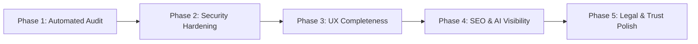

# Vibe Hardener: Production-Readiness Protocol

Transition quick prototypes, AI-generated codebases, and vibe-coded MVPs into robust, hardened, production-grade applications.

---

## 1. Trigger Conditions

Activate this protocol whenever:
- User asks to "harden", "audit", or "prepare [project] for production".
- User wants to remove "vibe coding giveaways" or fix security flaws in a web app.
- User is preparing to launch a SaaS, share a project publicly, or onboard real users.
- User mentions "unvibe my app" or asks for pre-launch checklists.

---

## 2. The 5-Phase Hardening Workflow



### Phase 1: Automated Audit Scan
Run the built-in diagnostic auditor to identify immediate leaks, missing files, and framework oversights:
```bash
python3 /home/sami/.agents/skills/vibe-hardener/scripts/audit.py <path_to_project>
```
Analyze the score and output breakdown:
- 🚨 **Critical Vulnerabilities:** Exposed keys, unconfigured gitignore, missing RLS, CORS wildcards.
- ⚠️ **Completeness Gaps:** Missing 404, missing skeleton states, missing legal pages.
- 🌐 **SEO & Discoverability:** Missing robots.txt, llms.txt, sitemaps, OpenGraph cards.

---

### Phase 2: Security & Backend Hardening
Review against [01-security-hardening.md](./references/01-security-hardening.md):
1. **Secrets & Git:** Verify no `.env` or API credentials exist in git history or client bundles.
2. **Supabase / Postgres RLS:** Ensure every table has `ALTER TABLE ... ENABLE ROW LEVEL SECURITY;` and strict ownership policies.
3. **Identity Verification:** Confirm that API routes never trust client-supplied `userId` parameters; always derive identity from server-verified sessions.
4. **Input Validation:** Wrap mutation payloads in Zod/Valibot schemas before executing database queries.
5. **Rate Limiting & Webhooks:** Verify rate limiting on auth/AI routes and cryptographic signature verification on webhook endpoints (Stripe, Clerk).

---

### Phase 3: UX & Functional Completeness
Review against [02-ux-completeness.md](./references/02-ux-completeness.md):
1. **Custom 404 / Error Boundaries:** Implement custom `not-found.tsx` and `error.tsx` with clear recovery links.
2. **Loading & Skeleton States:** Replace white-screen freezes with skeleton loaders (`loading.tsx` or animated pulse placeholders).
3. **Empty States:** Ensure all data lists show an empty illustration, explanation, and primary action when records are zero.
4. **Mobile Optimization:** Audit responsive breakpoints, verify 48px tap targets, and add a sticky mobile CTA if applicable.
5. **User Lifecycle:** Confirm the presence of account deletion ("Danger Zone") and data export options.

---

### Phase 4: SEO & AI Citation Discovery
Review against [03-seo-and-ai-discovery.md](./references/03-seo-and-ai-discovery.md):
1. **AI-Ready `robots.txt`:** Ensure search bots and AI crawlers (`GPTBot`, `ClaudeBot`, `PerplexityBot`, `Google-Extended`) are permitted.
2. **`llms.txt` Standard:** Create `public/llms.txt` outlining product capabilities, pricing, and doc links for LLM agents.
3. **Dynamic Sitemap & Metadata:** Ensure `sitemap.xml`, unique `<title>`, `<meta description>`, and 1200x630 OpenGraph preview cards exist.
4. **Semantic HTML:** Enforce exactly one `<h1>` per page, hierarchical headings, and descriptive `alt` tags on all images.

---

### Phase 5: Legal & Trust Polish
Review against [04-legal-compliance.md](./references/04-legal-compliance.md):
1. **Four Core Pages:** Ensure `/privacy`, `/terms`, `/refund`, and `/cookies` are live and linked in the footer.
2. **Cookie Consent:** Add an unobtrusive consent banner before setting tracking or analytics cookies.
3. **Real Business Identity:** Verify that the footer displays an official contact email, company name, and physical/registered address.
4. **Transparent Consent:** Verify explicit opt-in checkboxes for email capture (no pre-checked boxes).

---

## 3. Verification & Sign-Off

Check your implementation against the complete checklist in [05-master-verification-matrix.md](./references/05-master-verification-matrix.md).

After applying fixes, rerun the audit script:
```bash
python3 /home/sami/.agents/skills/vibe-hardener/scripts/audit.py <path_to_project>
```
Ensure the project achieves a **Production Readiness Score of 90+** with zero critical issues before declaring the application launch-ready.
